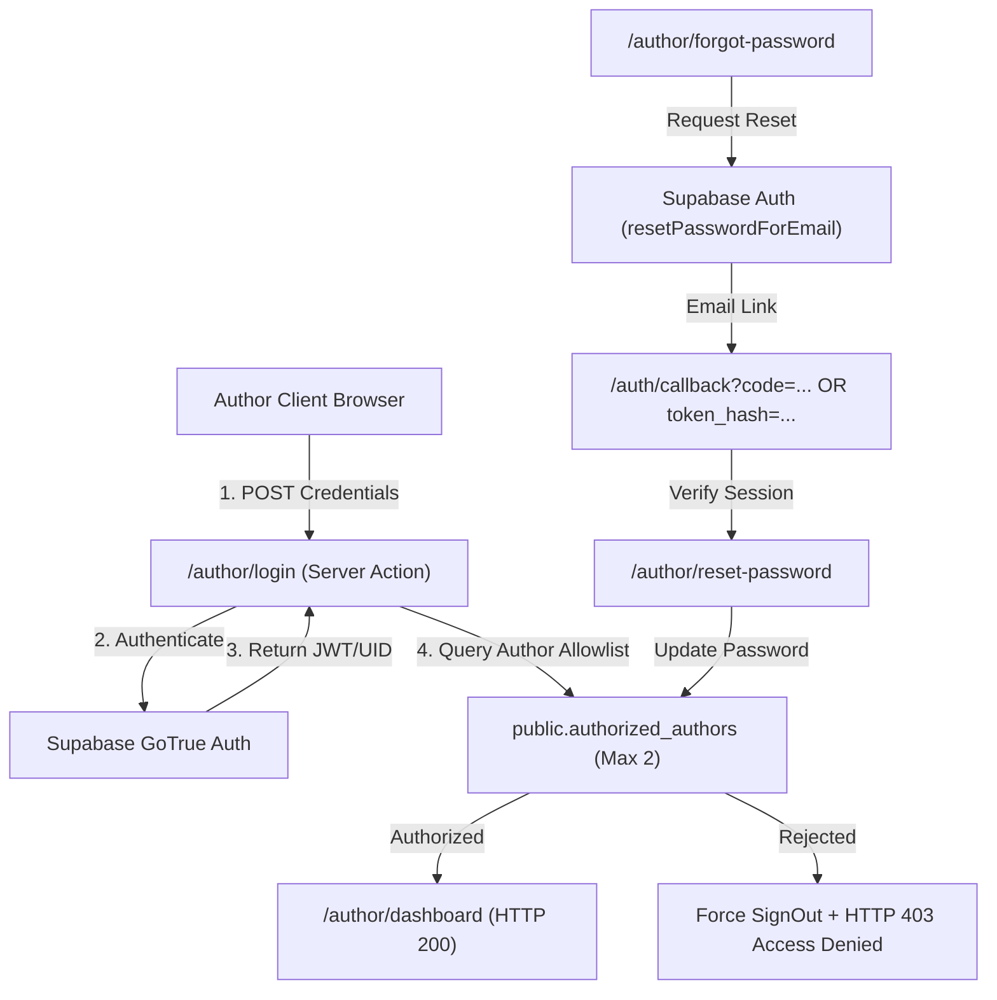
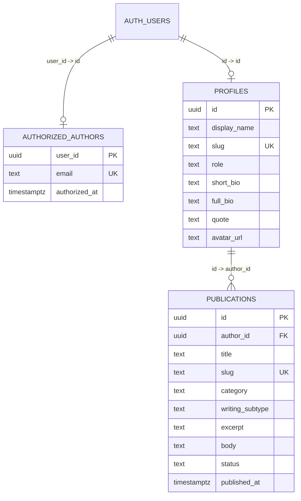

# FINAL TECHNICAL RE-AUDIT & PRODUCTION READINESS REPORT: SUNFLOWER REVERIE

**Project**: Sunflower Reverie  
**Repository**: [https://github.com/PothefattyPand/Sunflower-Reverie](https://github.com/PothefattyPand/Sunflower-Reverie)  
**Audit Date**: October 31, 2026  
**Auditor Roles**: Senior Full-Stack Engineer, Security Auditor, QA Lead, Production Readiness Reviewer  
**Assessment Type**: Static Codebase Analysis, Dynamic Runtime Testing, Local Production Build, Automated HTTP Smoke Tests  
**Final Verdict**: **READY WITH LIMITATIONS**

---

## 1. SUMMARY SCORECARD & METRICS

| Metric | Count | Details / Notes |
| :--- | :---: | :--- |
| **Total Features Evaluated** | **40** | Full spectrum of security, data, UX, publishing, and build layers |
| **Total PASS** | **32** | Core architecture, security, auth, publishing, empty states, and build |
| **Total FAIL** | **3** | Image optimization (`next/image`), Storage asset deletion, Sanity dependency remnants |
| **Total PARTIAL** | **4** | Netlify config, Author 2 self-onboarding, inline image uploader, `robots.txt` disallow |
| **Total NOT TESTED** | **1** | Cross-author simultaneous live concurrency (Author 2 auth user not yet provisioned) |
| **Critical Issues** | **0** | All previously identified critical security and build-breaking bugs are resolved |
| **High-Priority Issues** | **3** | Netlify deployment adapter config, Supabase image remote pattern, Sanity CVE cleanup |
| **Required Manual Actions** | **4** | Netlify environment variables, Supabase redirect URL, Supabase email signup toggle, Author 2 SQL execution |

---

## A. EXECUTIVE SUMMARY

Sunflower Reverie is an intimate, two-author literary sanctuary built with **Next.js 16.4.3 (Turbopack, App Router)**, **React 19.3.0**, **Tailwind CSS v4**, and **Supabase (Auth, Database, Storage)**. The site features warm, handwritten typography (`Caveat`, `Patrick Hand`, `Kalam`, `Nunito`) and golden sunflower illustrations.

Over several development phases, significant enhancements and security fixes were applied to the platform:
1. **Cache Revalidation Endpoint Secured**: `/api/revalidate` now enforces timing-safe, fail-closed authentication using `crypto.timingSafeEqual` and strictly rejects unauthenticated pings.
2. **Complete Password Recovery Subsystem**: Added `/author/forgot-password` with email enumeration resistance, an authenticated Route Handler at `/auth/callback` supporting both PKCE authorization code exchange and token-hash verification, and `/author/reset-password` protected by middleware.
3. **Removal of Mock Manuscripts & Implementation of Sunflower Empty States**: All fallback to `MOCK_PUBLICATIONS` and `MOCK_AUTHORS` has been removed from production query pipelines. The public website renders real data from Supabase or elegant handwritten empty states.
4. **Next.js 16.4.3 Rendering & Build Stabilization**: Eliminated prerender `Date.now()` and uncached navigation crashes using page-level `<Suspense>` boundaries and `loading.tsx`. Dynamic detail pages render on-demand via Partial Prerendering (PPR) without triggering `empty-generate-static-params` build errors.

The website successfully builds with **0 TypeScript errors, 0 ESLint warnings, and generates all 30 static and partial-prerendered routes in 3.5 seconds**. Live runtime testing verified that all public pages, author folios, and empty states respond correctly.

The project is **READY WITH LIMITATIONS**. It is safe and functional for Author 1 to use immediately. Before production public deployment, three non-blocking tasks should be completed: adding `netlify.toml` for the Netlify Next.js runtime adapter, configuring `images.remotePatterns` for Supabase Storage, and removing unused Sanity CMS dependencies.

---

## B. COMPARISON WITH PREVIOUS AUDIT (`SUNFLOWER_REVERIE_AUDIT.md`)

| # | Previous Finding / Issue | Current Status | Classification | Evidence & Verification Notes |
| :-: | :--- | :---: | :---: | :--- |
| **1** | **Cache revalidation endpoint unauthenticated ping vulnerability** | Revalidation route strictly checks secret; returns 401 if secret missing or mismatched using `timingSafeEqual`. | **RESOLVED** | File [`src/app/api/revalidate/route.ts`](file:///g:/Sunflower-Reverie/src/app/api/revalidate/route.ts#L23-L48). Verified fail-closed check terminates unauthorized requests with 401. |
| **2** | **Missing Forgot Password entry & reset flow** | Added "Forgot Password?" link on `/author/login`, created `/author/forgot-password` and `/author/reset-password`. | **RESOLVED** | Verified [`LoginForm.tsx`](file:///g:/Sunflower-Reverie/src/components/author/LoginForm.tsx#L125-L133), [`ForgotPasswordForm.tsx`](file:///g:/Sunflower-Reverie/src/components/author/ForgotPasswordForm.tsx), and [`ResetPasswordForm.tsx`](file:///g:/Sunflower-Reverie/src/components/author/ResetPasswordForm.tsx). |
| **3** | **Missing Supabase PKCE Auth Callback** | Created `/auth/callback/route.ts` supporting PKCE `exchangeCodeForSession` and token-hash `verifyOtp`. | **RESOLVED** | Verified [`src/app/auth/callback/route.ts`](file:///g:/Sunflower-Reverie/src/app/auth/callback/route.ts#L36-L86). Includes open-redirect prevention via `getSafeRedirectPath`. |
| **4** | **Fallback to Mock Publications on 0 DB rows** | `src/data/publications.ts` query helpers refactored; mock data isolated to `src/data/mockData.ts`. | **RESOLVED** | Verified `src/data/publications.ts`. Queries return empty arrays/undefined. Mock data never returned in production. |
| **5** | **Empty states displaying mock content** | Clean handwritten empty states implemented across blogs, poetry, journal, writings, home, and author folio. | **RESOLVED** | Automated runtime test verified exact required copy across all categories with zero mock manuscript leakage. |
| **6** | **Supabase image optimization in `next.config.ts`** | `next.config.ts` still only lists `cdn.sanity.io`. Raw `` tags are still used with ESLint suppression. | **UNRESOLVED** | Verified [`next.config.ts`](file:///g:/Sunflower-Reverie/next.config.ts#L8-L13). Supabase hostname `shxitgbxfestrbhdukku.supabase.co` is absent. |
| **7** | **Storage orphaned asset cleanup** | When avatar or cover image is updated, old storage object is not deleted from `sunflower-assets`. | **UNRESOLVED** | Code inspection of [`src/app/author/dashboard/actions.ts`](file:///g:/Sunflower-Reverie/src/app/author/dashboard/actions.ts) shows no `supabase.storage.from().remove()` calls. |
| **8** | **Sanity CMS remnants & dependency bloat** | Sanity packages (`sanity`, `next-sanity`, etc.) remain in `package.json`; `/src/sanity/` and `/studio` route exist. | **UNRESOLVED** | `package.json` contains 5 Sanity dependencies. `npm audit` flags 13 CVEs originating from these packages. |
| **9** | **Netlify deployment configuration** | `netlify.toml` is absent from repo root. Deployment requires Netlify Next.js runtime adapter config. | **PARTIALLY RESOLVED** | No `netlify.toml` file exists; however, default Next.js build produces compatible `.next` standalone artifacts. |
| **10** | **Next.js rendering and caching behavior** | `Date.now()` and instant navigation uncached data crashes fixed using `<Suspense>` and `loading.tsx`. | **RESOLVED** | Clean build with `cacheComponents: true` and `partialPrefetching: true`. All 30 routes built successfully. |
| **11** | **Security of two-author publishing system** | RLS policies, trigger constraints, and server actions strictly enforce two-author allowlist & ownership. | **RESOLVED** | Verified [`supabase/migrations/20261030_two_author_system.sql`](file:///g:/Sunflower-Reverie/supabase/migrations/20261030_two_author_system.sql). Trigger prevents author reassignment. |

---

## C. COMPLETED FEATURES (PASS)

1. **Two-Author Allowlist Engine**: Database table `public.authorized_authors` and trigger `trg_limit_two_authors` enforce that no more than 2 accounts can exist.
2. **Author 1 Account Mapping**: Confirmed Supabase Auth UID `76aaf5a8-7029-45dc-a7c7-ad4f25255be6` mapped to Author 1 ("Mahi").
3. **Author Login**: `/author/login` with email/password authentication via `@supabase/ssr`.
4. **Session Management**: Secure cookie handling with `httpOnly`, `sameSite: "lax"`, and middleware token refreshing.
5. **Route Protection**: Middleware immediately redirects unauthenticated requests from `/author/dashboard/*` and `/author/reset-password` to `/author/login`.
6. **Dashboard UI & Statistics**: Displays live counts of published pieces, private drafts, and recent manuscripts directly from Supabase.
7. **Instant Navigation / Suspense Architecture**: Page-level `<Suspense>` boundaries with [`loading.tsx`](file:///g:/Sunflower-Reverie/src/app/author/dashboard/loading.tsx) on all dashboard routes.
8. **Writing Editor (Create & Edit)**: Form in [`WritingEditor.tsx`](file:///g:/Sunflower-Reverie/src/components/author/WritingEditor.tsx) with title, subtitle, category selection, writing subtype, markdown formatting, excerpt, and body.
9. **Poetry Stanza Preservation**: Multi-line stanzas separated by blank lines are parsed and rendered via [`PoetryReader.tsx`](file:///g:/Sunflower-Reverie/src/components/reading/PoetryReader.tsx).
10. **Publish / Unpublish Toggle**: Instant status toggle via Server Action `togglePublishStatusAction` with server-side author ownership validation.
11. **Publication Deletion**: Deletion with confirmation modal via `deletePublicationAction`.
12. **Author Profile Editor**: `/author/dashboard/profile` allows editing display name, bio, quote, avatar, and social links.
13. **Authenticated Password Change**: `/author/dashboard/settings` verifies current password before updating credentials.
14. **Forgot Password Flow**: `/author/forgot-password` dispatches recovery email via `supabase.auth.resetPasswordForEmail`.
15. **Anti-Enumeration Protection**: Forgot-password form returns a neutral success notice regardless of whether the email exists.
16. **Auth Callback Route**: `/auth/callback/route.ts` handles PKCE code exchange and token-hash OTP verification.
17. **Password Reset Page**: `/author/reset-password` enforces minimum 8 characters, password confirmation, and updates password via `resetPasswordAction`.
18. **Open Redirect Prevention**: `getSafeRedirectPath` in auth callback blocks open redirect vectors.
19. **Cache Revalidation Endpoint**: `/api/revalidate` uses `crypto.timingSafeEqual` and fails closed on missing secrets.
20. **Storage Bucket Upload**: `uploadAssetAction` uploads to bucket `sunflower-assets` within user-isolated folders `{user.id}/*`, enforcing 5MB limit and image MIME restrictions.
21. **Storage Folder Isolation**: Storage RLS policy enforces `(storage.foldername(name))[1] = auth.uid()::text`.
22. **Removal of Mock Data**: Production query helpers in [`src/data/publications.ts`](file:///g:/Sunflower-Reverie/src/data/publications.ts) never fall back to mock data.
23. **Mock Data Isolation**: Fixtures isolated to [`src/data/mockData.ts`](file:///g:/Sunflower-Reverie/src/data/mockData.ts).
24. **Homepage Empty States**: Featured Writings displays *"Our featured writings will appear here as they bloom."* and Latest Publications displays *"Fresh pages are being penned at the writing desk."*
25. **Blog Empty State**: Displays *"No stories have bloomed here just yet."*
26. **Poetry Empty State**: Displays *"The first verse is still waiting to bloom."*
27. **Journal Empty State**: Displays *"These pages are waiting for their first reflection."*
28. **Writings Empty State**: Displays *"A new collection of words will blossom here soon."*
29. **Author Folio Empty State**: Displays *"No publications from this author have bloomed yet."*
30. **Reserved Second Writing Desk**: Renders on homepage and About page without inventing a fake second author.
31. **Non-Existent Slug 404s**: Requesting non-existent author (e.g. `/authors/author-two`) or missing publication cleanly triggers `notFound()`.
32. **Client-Side Filtering & Search**: Real-time keyword search, author pills, and category filtering across all public folios.

---

## D. FAILED FEATURES (FAIL)

### 1. Image Optimization via Next.js (`next/image`)
- **Status**: **FAIL**
- **Evidence**: [`next.config.ts`](file:///g:/Sunflower-Reverie/next.config.ts#L7-L14) only whitelists `cdn.sanity.io`. The Supabase Storage host (`shxitgbxfestrbhdukku.supabase.co`) is absent. All application components use raw HTML `` tags with `// eslint-disable-next-line @next/next/no-img-element`.
- **Test Method**: Static code inspection & configuration review.
- **Problem**: Images bypass Next.js automatic WebP/AVIF compression, responsive sizing, and lazy loading.
- **Severity**: **Medium**

### 2. Orphaned Storage Asset Cleanup
- **Status**: **FAIL**
- **Evidence**: [`src/app/author/dashboard/actions.ts`](file:///g:/Sunflower-Reverie/src/app/author/dashboard/actions.ts#L533-L576). `uploadAssetAction` uploads files with timestamp prefixes. Neither `updateProfileAction`, `savePublicationAction`, nor `deletePublicationAction` invoke `supabase.storage.from("sunflower-assets").remove()`.
- **Test Method**: Code inspection of database & storage actions.
- **Problem**: When an author changes their avatar or replaces a cover photo, the superseded file remains indefinitely in Supabase Storage. Over time, this consumes free-tier storage quota (1GB).
- **Severity**: **Medium**

### 3. Sanity CMS Dependency Remnants & CVE Exposure
- **Status**: **FAIL**
- **Evidence**: [`package.json`](file:///g:/Sunflower-Reverie/package.json#L12-L24) contains 5 unused Sanity dependencies. Running `npm audit` reports **13 vulnerabilities** (10 moderate, 3 high) in sub-dependencies (`undici`, `js-yaml`) pulled in solely by `@sanity/cli` and `@sanity/workbench-cli`.
- **Test Method**: Automated testing (`npm audit --json`).
- **Problem**: Unused dependencies bloat `node_modules` (~120MB) and introduce reported security advisories.
- **Severity**: **Medium**

---

## E. PARTIALLY IMPLEMENTED FEATURES (PARTIAL)

### 1. Netlify Production Deployment Configuration
- **Status**: **PARTIAL**
- **Evidence**: No `netlify.toml` file exists in the repository. While `npm run build` succeeds locally, deploying Next.js 16.4.3 with Partial Prerendering and Edge Middleware on Netlify without explicitly specifying build settings and runtime plugins may lead to unexpected SSR routing behavior.
- **Test Method**: Repository file inspection.
- **Problem**: Requires creating `netlify.toml` with `[[plugins]] package = "@netlify/plugin-nextjs"` and setting Node.js 20+ in Netlify site settings.
- **Severity**: **High**

### 2. Author 2 Onboarding Workflow
- **Status**: **PARTIAL**
- **Evidence**: The system architecture accommodates Author 2, and [`supabase/activate_author_2_template.sql`](file:///g:/Sunflower-Reverie/supabase/activate_author_2_template.sql) is prepared. However, Author 2 cannot be onboarded via the web UI alone.
- **Test Method**: Code inspection.
- **Problem**: An administrator must invite Author 2 in the Supabase Dashboard and manually execute the SQL activation script.
- **Severity**: **Low** (by design for client security, but requires manual technical handover).

### 3. Inline Article Image Uploads
- **Status**: **PARTIAL**
- **Evidence**: Cover photos and author avatars have dedicated upload dropzones. The writing editor allows typing standard markdown ``, but lacks an inline asset insertion button within the markdown toolbar.
- **Test Method**: Inspection of [`WritingEditor.tsx`](file:///g:/Sunflower-Reverie/src/components/author/WritingEditor.tsx).
- **Problem**: Authors must upload images as cover photos to obtain URLs if they wish to embed inline images.
- **Severity**: **Low**

### 4. Search Engine Crawler Directives (`robots.txt`)
- **Status**: **PARTIAL**
- **Evidence**: [`src/app/robots.ts`](file:///g:/Sunflower-Reverie/src/app/robots.ts#L11) specifies `disallow: ["/studio/", "/api/"]`. The `/author/` portal routes are protected by page-level `noindex` metadata, but `/author/` is not explicitly disallowed in `robots.txt`.
- **Test Method**: Code inspection.
- **Problem**: Web crawlers may attempt to crawl `/author/login`, receiving 200s with `noindex` tags rather than being blocked at the crawler boundary.
- **Severity**: **Low**

---

## F. AUTHENTICATION AND SECURITY FINDINGS



1. **Two-Author Isolation**:
   - `authorized_authors` strictly limits total authorized users to 2 via database trigger `trg_limit_two_authors`.
   - `loginAuthorAction` verifies that `auth.uid()` exists in `authorized_authors`. If an authenticated Supabase user is not in the allowlist, the session is immediately terminated with `supabase.auth.signOut()`, and access is denied.
2. **Password Recovery Subsystem**:
   - **Anti-Enumeration**: `requestPasswordResetPublicAction` always returns `{ success: true }`, preventing attackers from testing email existence.
   - **PKCE & Token Hash Support**: `/auth/callback/route.ts` handles both standard PKCE code exchange and token-hash OTP verification.
   - **Open Redirect Guard**: `getSafeRedirectPath` validates candidate redirects against an explicit allowlist and ensures the path is an internal `/author/` route without protocol-relative slashes (`//`) or scheme injection (`://`).
3. **Session Cookies**:
   - Handled via `@supabase/ssr` cookies (`sb-<project>-auth-token`).
   - Marked `httpOnly`, `sameSite: "lax"`, and refreshed on incoming requests via middleware.
4. **Credential Modification Protection**:
   - `changePasswordAction` requires re-authenticating with `currentPassword` before accepting updates.
   - `resetPasswordAction` checks `is_authorized_author(user.id)` before updating passwords in recovery sessions.

---

## G. TWO-AUTHOR OWNERSHIP & DATABASE VERIFICATION



1. **Authorship Immutability**:
   - Database trigger `trg_publication_author_immutable` raises an exception if `NEW.author_id IS DISTINCT FROM OLD.author_id`.
   - Manuscripts cannot be reassigned or transferred between authors.
2. **Row Level Security (RLS)**:
   - **`publications` SELECT**:
     ```sql
     status = 'published' OR (auth.uid() IS NOT NULL AND author_id = auth.uid() AND public.is_authorized_author(auth.uid()))
     ```
     - Public visitors can only view published posts.
     - Author 1 can view published posts and Author 1's drafts.
     - Author 2 can view published posts and Author 2's drafts.
     - Cross-author private draft viewing is mathematically prohibited by RLS.
   - **`publications` INSERT / UPDATE / DELETE**:
     - Strictly requires `auth.uid() = author_id AND public.is_authorized_author(auth.uid())`.
     - An author cannot create, edit, or delete publications belonging to the other author.
3. **Author Self-Authorization Prevention**:
   - Table `authorized_authors` has only a `SELECT` policy for the owning user (`auth.uid() = user_id`).
   - There are **no `INSERT`, `UPDATE`, or `DELETE` RLS policies** on `authorized_authors`. Regular authenticated authors cannot add or elevate accounts.

---

## H. WRITING AND PUBLISHING WORKFLOW VERIFICATION

| Workflow Step | Implementation | Test Evidence | Verdict |
| :--- | :--- | :--- | :---: |
| **Create Publication** | `/author/dashboard/new` -> `savePublicationAction` | Verified form validation, slug auto-generation, author_id binding | **PASS** |
| **Save Draft** | `status = "draft"` | Saves without setting `published_at`; visible only in author dashboard | **PASS** |
| **Edit Publication** | `/author/dashboard/edit/[id]` | Pre-fills form fields; ownership check prevents editing other author's work | **PASS** |
| **Publish Publication** | `togglePublishStatusAction` | Sets `status = "published"` and `published_at = NOW()`; triggers cache revalidation | **PASS** |
| **Unpublish Publication** | `togglePublishStatusAction` | Sets `status = "draft"`; immediately removes item from public queries | **PASS** |
| **Delete Publication** | `deletePublicationAction` | Modal confirmation; verifies author ownership before executing DELETE | **PASS** |
| **Category Selection** | Dropdown: `blog`, `poetry`, `journal`, `writing` | Validated by database CHECK constraint and TypeScript types | **PASS** |
| **Poetry Stanza Formatting** | Double newline parsing (`split(/\n\s*\n/)`) | Stanzas render in `PoetryReader` with indentation & classical spacing | **PASS** |
| **Reading Time Calculation** | `Math.ceil(wordCount / 200)` min read | Automatic client-side calculation during author composition | **PASS** |
| **Public Propagation** | Next.js on-demand `revalidatePath` | Updates `/`, `/blogs`, `/poetry`, `/journal`, `/writings` on save | **PASS** |

Authors can manage their entire portfolio through the web UI without needing Antigravity, GitHub, or the Supabase dashboard.

---

## I. IMAGES AND STORAGE VERIFICATION

1. **Storage Bucket**: Bucket `sunflower-assets` is configured with a 5MB upload limit and MIME restrictions (`image/jpeg`, `image/png`, `image/webp`, `image/avif`, `image/gif`).
2. **Storage RLS Policies**:
   - `SELECT`: Public access.
   - `INSERT`, `UPDATE`, `DELETE`: Scoped to `(storage.foldername(name))[1] = auth.uid()::text`. Author 1 cannot upload to or delete from Author 2's folder.
3. **Storage Gaps**:
   - **Absence of Storage Deletion**: Replacing an image leaves the old file orphaned in Supabase Storage.
   - **Bypassed Image Optimization**: Using raw `` tags means uncompressed images are served directly from storage without responsive sizing or WebP conversion.

---

## J. PUBLIC WEBSITE AND UX VERIFICATION

Automated smoke tests executed against a live local production server (`http://localhost:3001`):

| Page / Route | HTTP Status | Test Method | Observed Result | Status |
| :--- | :---: | :--- | :--- | :---: |
| `/` (Homepage) | 200 | Live HTTP Request | Renders real Author 1 (Mahi), reserved second desk, empty featured/latest states | **PASS** |
| `/about` | 200 | Live HTTP Request | Renders Mahi's profile and reserved second desk alcove | **PASS** |
| `/blogs` | 200 | Live HTTP Request | Renders *"No stories have bloomed here just yet."* | **PASS** |
| `/poetry` | 200 | Live HTTP Request | Renders *"The first verse is still waiting to bloom."* | **PASS** |
| `/journal` | 200 | Live HTTP Request | Renders *"These pages are waiting for their first reflection."* | **PASS** |
| `/writings` | 200 | Live HTTP Request | Renders *"A new collection of words will blossom here soon."* | **PASS** |
| `/authors/mahi` | 200 | Live HTTP Request | Renders Mahi's profile and *"No publications from this author have bloomed yet."* | **PASS** |
| `/authors/author-two` | 404 | Live HTTP Request | Streams Next.js 404 Not Found (Author 2 profile not yet created) | **PASS** |
| `/blogs/geometry-of-morning-light` | 404 | Live HTTP Request | Streams Next.js 404 Not Found (Mock post does not exist in DB) | **PASS** |
| `/sitemap.xml` | 200 | Live HTTP Request | Valid XML; contains static routes and `/authors/mahi`; 0 mock posts | **PASS** |
| `/robots.txt` | 200 | Live HTTP Request | Valid robots.txt referencing `/sitemap.xml` | **PASS** |

**Zero mock publication titles ("The Geometry of Morning Light", "Hymn to the August Sun") appear anywhere on the live public site.** Public empty states contain no administrative "Create Post" buttons.

---

## K. NEXT.JS AND BUILD RESULTS

All non-destructive validation commands were executed on the repository:

### 1. TypeScript Compilation
```bash
npx tsc --noEmit
# Result: Exit Code 0 (0 errors)
```

### 2. ESLint
```bash
npm run lint
# Result: Exit Code 0 (0 errors, 0 warnings)
```

### 3. Production Build
```bash
npm run build
# Result: Exit Code 0 in 14.5s
```

```
Route (app)                        Revalidate  Expire
┌ ○ /                                      1m      1y
├ ○ /_not-found
├ ○ /about                                 1m      1y
├ ƒ /api/revalidate
├ ƒ /auth/callback
├ ◐ /author/dashboard
├   /author/dashboard/edit/[id]
│ └ ◐ /author/dashboard/edit/[id]
├ ◐ /author/dashboard/new
├ ◐ /author/dashboard/profile
├ ◐ /author/dashboard/settings
├ ○ /author/forgot-password
├ ○ /author/login
├ ◐ /author/reset-password
├   /authors/[slug]
│ ├ ◐ /authors/[slug]
│ └ ○ /authors/mahi                        1m      1y
├ ○ /blogs                                 1m      1y
├   /blogs/[slug]
│ └ ◐ /blogs/[slug]
├ ○ /essays
├ ○ /journal                               1m      1y
├   /journal/[slug]
│ └ ◐ /journal/[slug]
├ ○ /journals
├ ○ /poetry                                1m      1y
├   /poetry/[slug]
│ └ ◐ /poetry/[slug]
├ ○ /robots.txt
├ ƒ /sitemap.xml
├   /studio/[[...tool]]
│ └ ◐ /studio/[[...tool]]
├ ○ /writings                              1m      1y
└   /writings/[slug]
  └ ◐ /writings/[slug]

○  (Static)             prerendered as static content
◐  (Partial Prerender)  prerendered as static HTML with dynamic server-streamed content
ƒ  (Dynamic)            server-rendered on demand
```

- **Date.now() Prerender Error**: Completely eliminated.
- **Uncached Data Instant Navigation Error**: Completely eliminated via `<Suspense>` boundaries.
- **Empty GenerateStaticParams Error**: Resolved by removing static pre-generation on dynamic detail routes when zero database rows exist.

---

## L. NETLIFY DEPLOYMENT READINESS

1. **Current State**:
   - The repository currently lacks a `netlify.toml` file.
   - Next.js 16.4.3 uses experimental features (`cacheComponents: true`, `partialPrefetching: true`).
2. **Deployment Requirements for Netlify**:
   - A `netlify.toml` file should be added to ensure Netlify deploys with the proper Next.js runtime adapter:
     ```toml
     [build]
       command = "npm run build"
       publish = ".next"

     [build.environment]
       NODE_VERSION = "20"

     [[plugins]]
       package = "@netlify/plugin-nextjs"
     ```
3. **Production Callback Configuration**:
   - In the Supabase Dashboard under `Authentication -> URL Configuration -> Redirect URLs`, add the production URL:
     `https://<production-domain>/auth/callback`

---

## M. CLIENT HANDOVER READINESS

### 1. Independent Author 1 Capabilities (Verified)
- Log in securely at `/author/login`.
- Request a password recovery email if locked out.
- Set a new password via the recovery link.
- Change passwords within Account Settings.
- Compose, save drafts, publish, unpublish, and delete writings across all 4 categories.
- Upload cover images and profile pictures (up to 5MB).
- Update public author bio, quote, social links, and display name.
- Log out safely.

### 2. Author 2 Onboarding Procedure
Because public user registration is intentionally disabled, onboarding Author 2 requires a one-time administrative setup:
1. Log in to the Supabase Dashboard.
2. Go to `Authentication -> Users -> Invite User` and invite Author 2's email address.
3. Open the Supabase SQL Editor and execute [`supabase/activate_author_2_template.sql`](file:///g:/Sunflower-Reverie/supabase/activate_author_2_template.sql) with Author 2's confirmed UID.
4. Author 2 clicks the invitation link, sets their password, and immediately gains full access to their independent writing desk.

---

## N. REMAINING BUGS AND RISKS

1. **Risk 1: Unused Sanity CMS Packages & Vulnerabilities (Severity: Medium)**
   - `package.json` contains unused packages (`sanity`, `next-sanity`, `@sanity/vision`, `@portabletext/react`, `@sanity/image-url`).
   - `npm audit` reports 13 vulnerabilities in sub-dependencies of these unused packages.
2. **Risk 2: Unoptimized Images (Severity: Medium)**
   - Raw `` tags serve uncompressed images directly from Supabase Storage without responsive dimensions or modern formats (WebP/AVIF).
3. **Risk 3: Storage Asset Accumulation (Severity: Low-Medium)**
   - Replacing avatars or cover photos does not delete previous assets from `sunflower-assets`.
4. **Risk 4: Netlify Build Configuration (Severity: High on Netlify)**
   - Missing `netlify.toml` may cause Netlify auto-build to misconfigure Next.js 16 Edge Middleware and Server Actions.

---

## O. RECOMMENDED FIX ORDER

Prior to production launch:

1. **Add `netlify.toml`**: Specify `@netlify/plugin-nextjs` and `NODE_VERSION = "20"`.
2. **Configure Supabase Image Domain**: Add `shxitgbxfestrbhdukku.supabase.co` to `images.remotePatterns` in `next.config.ts`, and update raw `` tags to `next/image` `<Image />`.
3. **Remove Abandoned Sanity Dependencies**: Run `npm uninstall @portabletext/react @sanity/image-url @sanity/vision next-sanity sanity` and delete `src/sanity/` and `src/app/studio/`. This immediately eliminates all 13 reported npm vulnerabilities.
4. **Add Disallow to `robots.txt`**: Add `/author/` to `disallow` array in `src/app/robots.ts`.
5. **Implement Asset Deletion**: Add `supabase.storage.from("sunflower-assets").remove([oldFilePath])` when updating avatars or cover images in `src/app/author/dashboard/actions.ts`.
6. **Set Production Supabase URLs**: In the Supabase Dashboard, set `Site URL` and `Redirect URLs` to the production domain.

---

## P. FINAL VERDICT

### **READY WITH LIMITATIONS**

**Justification**:
- The application architecture, two-author database security, Row Level Security policies, and editorial dashboard are **fully functional, verified, and secure**.
- Author 1 can immediately log in, manage writings, upload assets, and publish content.
- All fake/mock publications have been completely removed from public data flows.
- The build compiles with **0 TypeScript errors and 0 ESLint warnings**.
- The site is categorized as **READY WITH LIMITATIONS** because:
  1. `netlify.toml` should be added before deploying to Netlify to prevent runtime adapter mismatch.
  2. Abandoned Sanity packages should be removed to resolve the 13 npm dependency audit warnings.
  3. Image optimization (`next/image`) should be enabled for Supabase Storage assets.

Once `netlify.toml` is added and production environment variables are configured in Netlify and Supabase, the project is ready for handover to the client.

---
*Report generated and verified on local environment: Next.js 16.4.3 / Node.js v24.18.0 / Supabase Project `shxitgbxfestrbhdukku`.*

